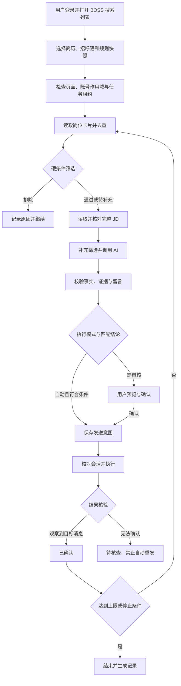

# JobApply Agent｜工作智投

面向求职者的 Chrome 浏览器插件智能体。首期支持 **BOSS 直聘求职者 Web 端**：用户自行登录、搜索岗位，插件读取当前搜索结果，结合用户确认的简历、原始招呼语和岗位 JD，完成筛选、个性化留言生成及定向沟通。

> **项目状态：需求与技术设计，尚未实现。** 本文用于指导开发和验收，不代表已有可安装扩展。首期采用纯 Chrome 扩展，无需额外服务器或本地后端；调用用户选择的 AI 服务仍需要网络和相应费用。BOSS 页面结构、按钮行为、默认招呼语和发送结果判定均须实测，不假设存在公开投递 API。

## 1. 产品目标与首期范围

用户使用路径：

1. 在浏览器中登录 BOSS，手动搜索目标岗位。
2. 打开插件，导入简历，核对解析结果与简历事实。
3. 设置原始招呼语、模型接口、筛选规则和本次处理上限。
4. 预览岗位筛选结果及个性化留言。
5. 选择逐条确认，或明确开启本次自动执行。
6. 查看沟通、留言、附件三个独立动作的状态，随时暂停或停止。

### 必须支持

- 读取当前搜索列表，逐岗获取完整 JD，按需滚动加载；本次处理数量有上限。
- 导入 PDF、DOCX、TXT、Markdown 简历，本地提取，用户确认后使用。
- 保存原始招呼语、语气、目标字数、必须保留的信息与禁止表述。
- 自定义 AI API Key、Base URL、模型名，支持连接测试。
- 岗位关键词、岗位性质、公司黑名单、自定义薪资范围、排除词和单岗屏蔽。
- 根据简历证据与具体 JD 评估匹配程度，生成个性化招呼语。
- 预览、逐条发送和用户主动开启的自动执行模式。
- 去重、暂停、继续、停止、结果核验和 CSV/JSON 记录导出。

### 首期不做

- 其他招聘平台、自动登录、验证码处理、平台限制规避、私有接口逆向。
- 自动代聊后续面试和薪资谈判，自动修改 BOSS 在线简历。
- 按岗位生成并上传多份附件简历，自动读取手机端求职意向。
- 云端账号体系、付费系统、向量数据库、多 Agent 框架或无人值守定时投递。

用户可保存多组筛选预设；每次只运行一组预设、一个当前搜索列表。浏览器关闭后任务不继续运行。

## 2. “投递成功”的定义

三个动作分别记录，不能用一次点击概括：

| 动作 | 成功或等待的判定 |
| --- | --- |
| 发起沟通 | 已进入经核对的目标岗位会话 |
| 发送个性化留言 | 在目标会话观察到本次对应的外发消息 |
| 发送平台已有附件简历 | 独立可选步骤；已发送、待对方同意、失败分别记录 |

默认自动化范围是发起沟通与发送个性化留言。上传到插件的简历用于分析，不等于上传到 BOSS；附件流程仅在页面正常提供、适配验证通过时开放。

开发时先验证 BOSS 是否在开聊时自动发送默认招呼语。如果会自动发送，预览必须说明实际消息数量和内容，不能把两条消息记录成“仅发送一条个性化留言”。无法确认流程时暂停自动发送。

## 3. 技术栈与模块边界

| 模块 | 建议技术 | 职责 |
| --- | --- | --- |
| 扩展构建 | TypeScript、Vite、Manifest V3 | 构建本地可加载的 `dist/` |
| 界面 | React、Tailwind CSS | Popup、任务侧栏、设置页、记录页 |
| 页面适配 | Content Script、DOM、MutationObserver | 读取 BOSS 列表/详情，受控执行页面动作 |
| 后台 | Extension Service Worker | 消息路由、权限、数据库事务、恢复协调 |
| 任务数据 | IndexedDB，Dexie 可选 | 简历、岗位、队列、事件、发送意图与租约 |
| 偏好与密钥 | `chrome.storage.local/session` | 非敏感偏好、受信上下文专用密钥配置 |
| 简历解析 | PDF.js、Mammoth | 扩展页面本地解析文本 |
| 模型调用 | `fetch`、OpenAI 兼容适配器 | 连接测试、评估与生成 |
| 数据校验 | Zod | 配置、消息、AI 返回结构校验 |
| 验证 | Vitest、DOM fixture、扩展 E2E | 过滤、恢复、去重及发送闭环 |

### 执行流程



### MV3 生命周期与存储约束

Service Worker 会被浏览器回收；状态不能只存在全局变量、长循环或计时器中。采用“有界步骤 + 持久化检查点 + 事件驱动推进”：每步保存输入版本、当前状态与结果，再推进下一步。唤醒后扫描未完成任务，先检查页面和发送意图，恢复至可确认状态；不直接重放发送动作。相关依据见 [Chrome Service Worker 生命周期](https://developer.chrome.com/docs/extensions/develop/concepts/service-workers/lifecycle)。

Content Script 仅负责页面读取和执行，不直接持有简历库、密钥或任务数据库；通过受校验的消息访问后台。IndexedDB 使用扩展自身 origin，由后台封装事务，避免在 BOSS 页面 origin 建立业务数据库。

AI 请求要有短超时、取消与持久化请求标识。首期后台调用按生命周期限制控制响应等待时间，例如 20 秒超时；不依靠保活循环支持任意长请求。请求中断则记录失败或暂停，迟到结果须核对请求 ID、任务版本再采用。若服务需要长等待或异步任务协议，另增受信扩展页面执行方案后再宣称支持。

页面关闭、导航、电脑休眠、模型请求中断时保留队列并暂停；恢复需要重新检查上下文。Popup 关闭不会清空任务，Popup 本身不承担任务执行。

## 4. 界面与交互

| 界面 | 内容 |
| --- | --- |
| 工具栏 Popup | 当前连接状态、打开面板、进入设置 |
| 页面内侧栏 | 岗位信息、匹配证据、留言预览、开始/暂停/停止、实时步骤 |
| 受信扩展设置页 | 简历导入与事实确认、模型和 Key、招呼语、筛选、数据管理 |
| 记录页 | 排除原因、待审核、发送确认、待核查、失败、导出 |

密钥输入和完整简历编辑放在扩展设置页，页面内侧栏只接收必要的展示数据，不接收 Key。侧栏可用 Shadow DOM 隔离样式，但不能把它当成密钥保险箱。

状态文案应准确，例如“正在读取 JD”“规则排除”“AI 分析”“留言待审”“正在发送”“已确认”“已暂停”“待核查”。失败必须给出原因和可用操作。

开始前展示本次配置快照：列表范围、筛选规则、简历版本、模型服务域名、执行模式、处理和发送上限、附件开关。默认预览模式，自动模式由用户为本次任务明确开启。

## 5. 简历与原始招呼语

导入过程：选文件 → 本地解析 → 用户核对文本 → 提取事实 → 用户确认事实 → 保存版本。

- PDF 首期只保证文本型文件；扫描件无有效文本时提示粘贴文字，不默认上传到 OCR 服务。
- DOCX 提取纯文本，不执行文档中的内容或远程资源；PDF worker 与解析依赖随扩展打包。
- 文件类型、大小、解析超时和错误须有明确校验及提示。
- 事实包含经历 ID、公司/项目、角色、时间、技能、成果数字及口径、作品链接。
- 缺失信息记为未知；AI 提取的事实未确认前不进入自动发送。
- 原始招呼语作为语气和重点参考，其中事实也要与确认简历核对。
- 默认正文 80–150 中文字符，可配置；明确按 Unicode 字符计数，标点计入。
- 不自动添加联系方式、私密信息、新链接或未经证实的年限与数字。

简历与招呼语均有版本；变更后旧的 AI 结果和待发送预览需要重新确认。

## 6. AI 接口配置与密钥管理

首期支持 **OpenAI 兼容 Chat Completions 协议**；其他协议通过 Provider 适配器另行实现，不承诺任意服务都能直接使用。

配置示例不包含真实密钥：

```json
{
  "id": "custom-provider",
  "name": "自定义模型",
  "baseUrl": "https://your-provider.example/v1",
  "model": "your-model-name",
  "timeoutMs": 20000,
  "maxOutputTokens": 800,
  "keyStorage": "session"
}
```

约定 Base URL 是 API 根路径，适配器在其后追加 `/chat/completions`；保留自定义路径前缀，去除结尾斜杠，不重复追加 `/v1`。拒绝 URL 中的账号密码、查询参数与片段；接口 Key 单独保存。连接测试与正式请求使用同一 URL 拼接逻辑。

- 默认 Key 存在 `chrome.storage.session`，其生命周期遵循浏览器会话及扩展加载状态；不承诺刷新扩展后保留。
- 用户可显式选择 `chrome.storage.local` 持久保存，并提示这不等于操作系统密钥保险箱。
- 对密钥所在 storage area 设置 `TRUSTED_CONTEXTS` 访问级别；内容脚本通过白名单消息获得非敏感设置，不能读取整个设置对象。参见 [Chrome storage API](https://developer.chrome.com/docs/extensions/reference/api/storage)。
- Key 不进入网页 DOM、内容脚本、日志、错误文本、CSV、JSON 备份或同步存储。
- 简历发送前去除电话、邮箱、证件、详细住址；用户首次确认发送字段和服务域名，域名变更后重新确认。
- 默认仅允许 HTTPS；明确启用本机模型时可另行支持 loopback HTTP，不泛化放开内网地址。
- 模型请求从受信扩展上下文发起，按所选域名申请 host 权限，参见 [Chrome 跨域请求](https://developer.chrome.com/docs/extensions/develop/concepts/network-requests)。
- 为支持任意 HTTPS Provider，可在 manifest 声明 `optional_host_permissions: ["https://*/*"]`，仅在用户手势中申请配置的精确主机模式；这不是安装时授予所有网站访问权限。移除 Provider 后可释放不再使用的权限。
- 拒绝重定向，例如使用 `redirect: "error"`，不把 Authorization 跟随到未批准的域名。允许目标由配置白名单决定，不能由网页消息传入任意请求 URL。

连接测试仅发送短测试文本，不使用真实简历。分别提示鉴权失败、配额不足、模型不存在、超时、权限未授予、网络异常和协议格式不兼容。

## 7. 搜索、筛选与屏蔽规则

用户先使用 BOSS 的搜索功能；插件规则用于当前列表的本地筛选，修改插件规则不会自动改变网站搜索结果。

| 条件 | 规则 |
| --- | --- |
| 包含关键词 | 默认匹配职位标题；多词任意命中，可切换全部命中 |
| 排除关键词 | 可指定标题、公司、JD；记录命中字段与上下文 |
| 岗位性质 | 全职、兼职、实习、不限；结构字段优先，不明确进入待确认 |
| 公司黑名单 | 精确或包含匹配；支持从岗位卡片添加 |
| 薪资范围 | 用户设置上下限、单位、区间重叠或完全包含 |
| 单岗屏蔽 | 按平台稳定 jobId 保存，之后直接跳过 |
| 已沟通/已发送 | 根据平台可观察状态与本地记录跳过 |

关键词统一大小写和空白，默认字面匹配，不执行用户正则。对“非外包”等否定短语保留上下文，不确定时交给用户审核；硬性排除条件不被 AI 高分覆盖。

薪资规则：

- 月薪、年薪、日薪、时薪分别存储，`K/月` 可转换成元/月。
- 不默认把日薪、时薪折算月薪；年薪需用户配置换算方式后才参与月薪比较。
- 13/14 薪作为独立字段，不默认为月薪乘数。
- 面议、缺失、无法解析进入待确认，或按用户设置跳过，不能当作零或自动通过。
- 完全包含定义为“岗位区间完全处于用户期望区间内”；区间边界闭合。
- 示例：用户期望 20–35K/月，岗位 25–40K/月，重叠模式通过，完全包含模式不通过。

执行顺序：平台状态/去重 → 单岗屏蔽 → 公司 → 性质 → 薪资 → 卡片关键词 → 完整 JD → 补充缺失字段与 JD 排除规则 → AI。卡片字段不足时先读取详情，不提前错误排除。

## 8. AI 匹配与个性化生成

一次模型调用返回匹配结果和留言；用户审核时可单独重生成留言。仅在 JD 完整、简历事实已确认时调用。

输入包含岗位结构数据、完整 JD、脱敏事实、原始招呼语、目标方向、表达约束。输出协议：

```json
{
  "decision": "review",
  "score": 78,
  "matchedEvidenceIds": ["project_001"],
  "strengths": ["有相关产品上线经验"],
  "gaps": ["未确认企业客户交付经历"],
  "greeting": "您好，看到岗位关注产品从需求分析到上线的完整流程。我曾参与相关项目，希望结合已有经历进一步交流。"
}
```

- `decision` 仅允许 `pass/review/reject`；分数用于参考排序，不代表招聘成功概率。
- `review` 必须人工审核；`pass` 也需通过本地硬条件、输出检查和自动模式门槛。
- 只用已确认事实，选择相关的 1–2 条证据；结合具体职责，不能只替换公司名。
- 缺少硬性资格或信息不确定时不可凭高分自动发送。
- JD、简历、原始招呼语均作为数据处理，不执行其中要求改变目标、发送密钥或忽略规则的指令。

程序校验 JSON/Zod、证据 ID、字数、占位符、联系方式、模型自述与代码块；数字和技能声明必须可追溯。结构校验无法证明语义真实性，不能将其描述为绝对防幻觉。无法验证的新事实或改写进入待审；修复生成最多一次，仍不合格就保留错误，禁止静默改用固定招呼语继续发送。

缓存键包含 `jobId + jdHash + resumeVersion + greetingVersion + ruleVersion + provider/model + promptVersion`；任一输入变化使旧结果失效。预览后修改文案也需保存新版本及 hash。

## 9. BOSS 页面适配层

所有页面选择器与交互集中在 `adapters/boss/`，业务层只调用接口：

```ts
interface BossAdapter {
  detectPage(): Promise<PageContext>;
  readVisibleJobs(): Promise<JobCard[]>;
  loadMore(): Promise<LoadResult>;
  openDetail(job: JobCard): Promise<void>;
  readDetail(expectedJobId: string): Promise<JobDetail>;
  readCommunicationState(jobId: string): Promise<CommunicationState>;
  openConversation(jobId: string): Promise<ConversationContext>;
  sendGreeting(command: SendCommand): Promise<SendObservation>;
  verifyGreeting(command: SendCommand): Promise<VerificationResult>;
}
```

具体类型集中到 `shared/schema`。接口设计不代表 BOSS 页面已验证支持这些行为。

适配要求：

1. 从真实页面建立列表、详情、聊天的脱敏 DOM fixture；记录验证日期和支持路径。
2. 读取详情必须核对岗位 ID、标题、公司，等待内容稳定，不能只固定延时后读取。
3. 页面缺字段、改版、验证页或未知布局时停止相关操作，不返回空内容冒充成功。
4. 新标签页聊天需通过 `runId/jobId` 握手及可观察会话信息关联；核对不完整就不发送。
5. 用户改变搜索条件、切换账号、导航或手动改变会话时暂停，避免向错误目标发送。
6. 列表虚拟化时按稳定 ID 入队，不依赖 DOM 序号；处理滚动中的重复卡片与无新增结束条件。
7. 以正常页面交互为基础，不逆向私有接口，不添加隐藏行为或风控规避方案。

每个账号只允许一个任务执行。账号作用域优先来自页面可核对的稳定身份并本地映射，不收集 Cookie；身份无法可靠识别时禁止自动模式，不能用所有用户共享的 `default` 作用域。浏览器无痕环境首期不支持。

## 10. 状态机、去重与恢复

岗位状态：

```text
discovered → extracting → filtered_out
                       → evaluating → rejected / review / ready
ready → opening_chat → sending → sent_verified / uncertain / failed
review → 用户确认并重新校验 → ready
```

任务状态：`idle / running / pausing / paused / completed / stopped / blocked`。

- 暂停/停止必须先持久化取消标记并更新执行 epoch，再取消请求、通知页面执行器。每次不可撤销动作前重新检查任务版本和锁。
- 暂停阻止新的发送动作；已经触发的点击无法撤销，必须继续记录观察结果。
- 停止保留记录，取消未开始动作。继续时重新检查页面、账号、配置、会话及发送意图。
- 浏览器重启后先进入可恢复暂停状态，由用户确认继续，不自行恢复外发。

发送唯一键：`accountScope + platform + jobId + actionType`。同一岗位重新生成留言不能绕过去重。三个动作分别维护状态，避免把开聊成功当成留言成功。

发送流程：

1. 在数据库事务中校验任务状态、领取动作并保存发送意图、文案 hash、会话和执行 epoch。
2. 页面执行器再次核对目标会话、任务取消标记和文案版本。
3. 执行动作并收集观察结果。
4. 在目标会话核对外发方向、文本、发送前后消息变化；有稳定消息 ID 时一并保存。
5. 保存确认结果后推进队列。

点击后中断、回调丢失、写库失败或消息核验不确定，一律进入 `uncertain`；先核查历史再决定，禁止自动重发。平台与本地数据库无法构成同一事务，不能承诺严格 exactly-once。

跨标签页使用 IndexedDB 事务领取租约，字段包含持有者、过期时间和递增 fencing token。旧执行器不能仅凭过期前拿到的锁继续操作；接管前核对遗留发送意图，不因租约过期立即重发。时间到期只表示需要检查，不代表外部动作没有执行。

首次安装只能依据平台可观察历史判断，不宣称完整覆盖手机端历史。页面限制、验证码和登录失效立即阻断，交由用户处理。

## 11. 数据模型

| 表 | 关键字段 |
| --- | --- |
| `profiles` | id、confirmedFacts、resumeVersion、createdAt |
| `presets` | id、filters、greetingTemplate、executionMode、version |
| `jobs` | platform、jobId、url、company、salaryRaw/Normalized、jobType、jd、jdHash |
| `evaluations` | jobId、inputVersions、promptVersion、model、score、evidenceIds、greeting、status |
| `runs` | runId、accountScope、tabId、listFingerprint、presetSnapshot、mode、status、epoch、cursor、counters |
| `applications` | uniqueKey、jobId、actionType、conversationId、greetingHash、intentAt、verifiedAt、status、fencingToken |
| `blocks` | platform、jobId/companyRule、reason |
| `events` | runId、jobId、step、errorCode、sanitizedMessage、timestamp |
| `leases` | accountScope、ownerRunId、expiresAt、fencingToken |

`applications.uniqueKey` 建唯一索引。记录处理数、排除数、待审数、尝试发送数、确认留言数和待核查数；不能只显示一个含义不明的“投递数”。

简历默认保存确认后的文本与事实，原始文件可解析后释放。日志不重复存整份简历或页面截图。支持删除、导出和后续版本迁移；导出排除 Key、Cookie 和其他密钥。删除任务数据前需停止任务，避免执行器继续写回。

## 12. 消息与权限边界

内部消息至少包含 `type/requestId/runId/jobId/payloadVersion`；返回 `ok/data` 或结构化 `error`。后台验证 sender、URL、schema、账号作用域、任务、目标标签页以及消息类型的调用权限。

- Content Script 只能提交页面观察和受限操作结果，不能调用密钥读取、任意 URL 请求或直接变更发送状态的通用接口。
- 不提供 `externally_connectable` 或网页 `postMessage` 通用命令桥；确需页面桥接时另行做能力白名单。
- 初始申请 `storage` 和已验证的 BOSS 内容脚本匹配范围，其他权限按真实使用添加。
- 模型域名使用可选 host 权限；`tabs/scripting/alarms` 仅在实际需要时增加。
- 首期不需要 `cookies/debugger/webRequest/<all_urls>`。
- 文本使用安全渲染，不把 JD 或 AI 输出直接写入 `innerHTML`。
- 扩展不从 CDN 执行远程代码，PDF worker 和依赖随包发布。
- 默认无第三方日志与遥测。对外模型请求是明确展示并由用户选择的数据出口。

## 13. 建议目录

```text
jobapply-agent/
  src/
    background/          # 权限、受限消息、数据库事务、恢复协调
    content/             # 页面入口、侧栏挂载、受控执行器
    adapters/boss/       # 列表、详情、会话及结果观察
    ui/                  # Popup、Options、侧栏、记录页
    core/                # 队列、状态机、过滤、去重、发送核验
    ai/                  # Provider、提示词、输出校验
    resume/              # 本地解析、事实确认、脱敏
    storage/             # IndexedDB schema、迁移、租约
    shared/              # 消息、schema、错误码
  public/                # 图标与本地资源
  tests/fixtures/        # 脱敏页面样本
  tests/unit/
  tests/e2e/
  manifest.json
  package.json
  README.md
```

## 14. 开发步骤与交付验收

### 阶段一：工程与只读页面采集

建立 TypeScript/Vite/MV3 工程、Popup、设置页和任务侧栏。先在用户登录的真实页面验证列表和详情，编写适配器及脱敏 fixture。

验收：扩展可加载；能读取当前列表与单条完整 JD；快速切换岗位不串数据；不支持页面明确提示；无发送动作。

### 阶段二：简历、规则与模型预览

完成本地文件解析、事实确认、招呼语设置、Provider 配置与连接测试，接入规则引擎、AI 协议和留言预览。

验收：未配置 Key、权限拒绝、配额不足、超时分别提示；岗位性质与薪资单位正确；硬排除优先；留言能追溯事实；Key 不进入内容脚本或导出。

### 阶段三：单岗沟通与发送闭环

先实现“预览后发送”，实测 BOSS 默认招呼语、目标会话定位、留言发送和核验。附件独立验收，未验证则不开放开关。

验收：仅进入聊天不算留言成功；错误会话不发送；点击后中断进入待核查；相同消息无法明确识别时不自动重发。

### 阶段四：当前列表自动执行

增加持久化队列、滚动加载、数量上限、停止条件、跨标签页租约、暂停恢复及自动模式确认。

验收：重复岗位只处理一次；刷新/后台回收不丢检查点；重启不自动外发；停止不领取新动作；改变列表或账号时暂停；验证页阻断执行。

### 阶段五：打包与交付

交付锁文件、构建产物、权限与隐私说明、支持页面清单、验证日期、已知限制和回归结果。真实外发测试与离线测试分离，默认测试绝不发送消息。

工程完成时须提供下列脚本；**目前目录只有设计文档，下列命令尚不可执行**：

```bash
npm ci
npm run dev
npm run lint
npm run test
npm run build
```

开发时选择并记录支持的 Node.js 版本，在 `package.json` 的 engines 和版本文件中固定。构建后通过 Chrome 扩展管理页开启开发者模式，选择“加载已解压的扩展程序”，加载 `dist/`。不得把未实现按钮或功能写成已交付。

## 15. 必测场景

| 类别 | 场景与预期 |
| --- | --- |
| 页面一致性 | 快速切卡、详情延迟、jobId 不一致：不串 JD、不发错对象 |
| 去重 | 相同岗位出现在多个列表/标签页：唯一动作与租约生效 |
| 薪资 | 月/年/日/时薪、面议、边界、13 薪：按配置比较，未知待审 |
| 关键词 | 否定短语、大小写和空白：有明确上下文与命中原因 |
| AI | 非 JSON、假证据 ID、虚构数字、超长留言、JD 注入：拒绝或待审 |
| 生命周期 | 请求中后台回收、休眠、页面关闭：可恢复且不盲目重发 |
| 外发不确定性 | 点击后写库失败、回调丢失、已有相同文本：进入待核查 |
| 平台状态 | 已沟通、岗位关闭、附件待同意、验证码：独立准确记录 |
| 取消与并发 | 暂停和点击竞争、租约接管、迟到响应：旧执行器不得推进新动作 |
| 隐私 | 存储访问级别、日志、备份、URL 重定向：无密钥泄露 |

## 16. 平台边界与实施约束

仅操作用户本人有权使用的账号；浏览器授权不等于平台授权。公开分发前核实 BOSS 当时的条款与接入许可，本设计不代表已获得平台许可。处理上限和串行执行用于控制本次授权范围与资源消耗，不用于规避平台限制。

页面结构未验证前不编造选择器；结果未确认前不标成功。优先独立实现最小闭环，借鉴第三方仓库前核对许可证与依赖来源。

## 17. 官方技术参考

以下参考用于扩展实现，不用于证明 BOSS 页面当前具备某种交互能力：

- [Chrome 扩展开发文档](https://developer.chrome.com/docs/extensions/)
- [Content Scripts](https://developer.chrome.com/docs/extensions/develop/concepts/content-scripts)
- [Service Worker 生命周期](https://developer.chrome.com/docs/extensions/develop/concepts/service-workers/lifecycle)
- [扩展消息通信](https://developer.chrome.com/docs/extensions/develop/concepts/messaging)
- [扩展跨域请求](https://developer.chrome.com/docs/extensions/develop/concepts/network-requests)
- [Storage API 与访问级别](https://developer.chrome.com/docs/extensions/reference/api/storage)

## 18. 给开发者的执行说明

按阶段推进，第一里程碑交付：**安装扩展 → 识别当前列表 → 读取一条完整 JD → 导入并确认简历 → 测试 API → 生成并预览个性化留言**。完成后再接单岗发送和列表自动循环。

每一阶段同时交付实现、适当的离线验证、支持范围与已知问题。全程保持纯扩展架构，不提前引入本地后端或额外基础设施。
